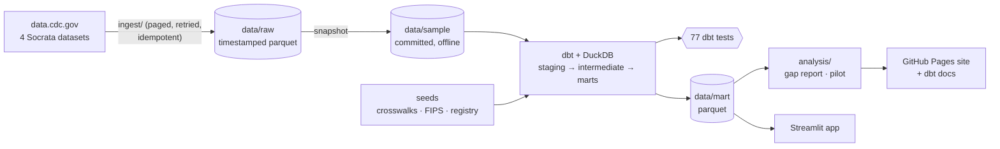
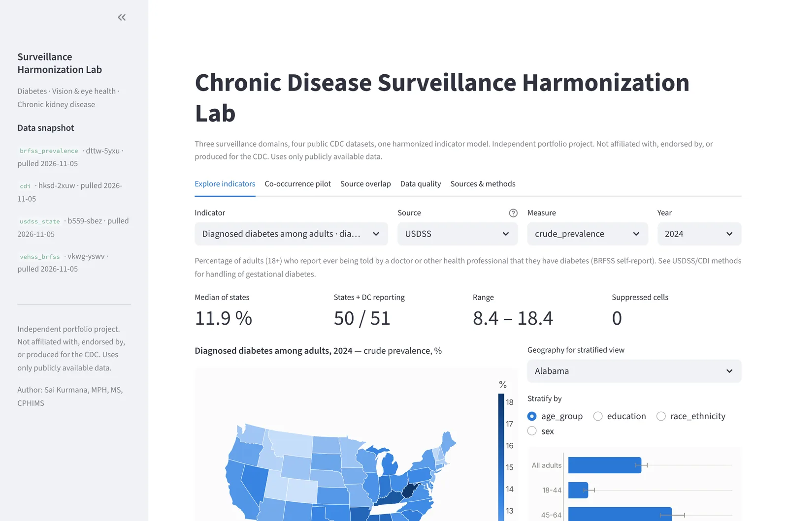
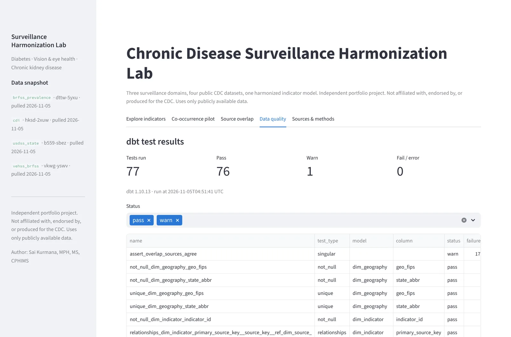
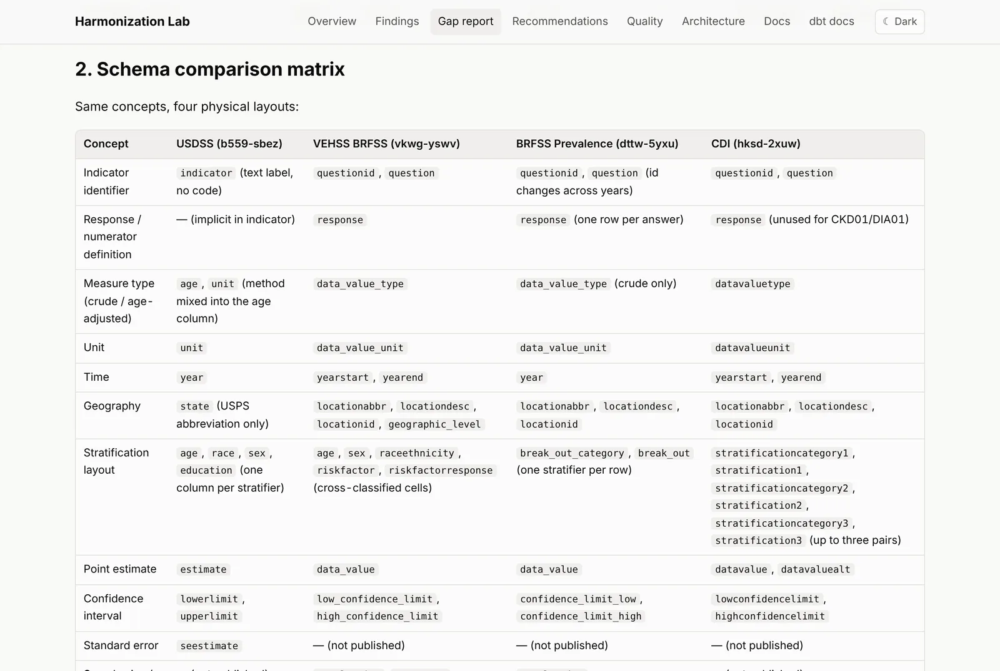
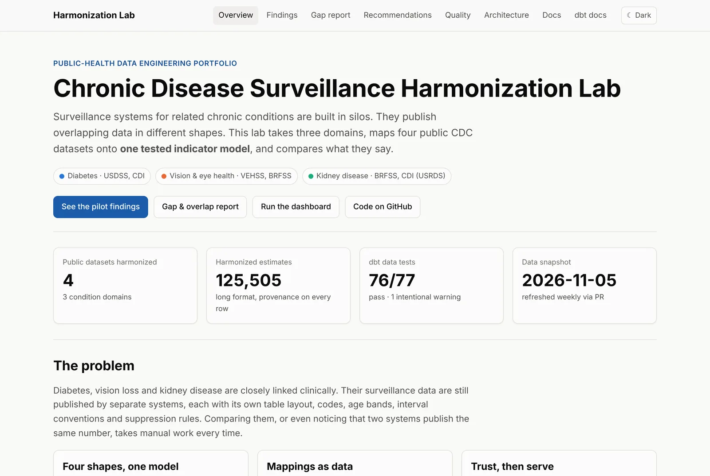

# Chronic Disease Surveillance Harmonization Lab

[](https://github.com/SaiKurmana/chronic-disease-surveillance-harmonization/actions/workflows/ci.yml)
[](https://github.com/SaiKurmana/chronic-disease-surveillance-harmonization/actions/workflows/pages.yml)

Harmonizing public **diabetes**, **vision & eye health**, and **chronic kidney disease**
surveillance data into one common, tested indicator model, and comparing what the
systems say.

> **Independent portfolio project. Not affiliated with, endorsed by, or produced for the CDC. Uses only publicly available data.**

- **Live site:** <https://saikurmana.github.io/chronic-disease-surveillance-harmonization/> _(placeholder: live after GitHub Pages is enabled; see [Deploying](#deploying))_
- **Interactive dashboard:** _placeholder: not yet hosted. Run it locally with `make app` (see [Quickstart](#quickstart))_

## The problem

Diabetes, vision loss and kidney disease are clinically linked. Diabetes is a leading
cause of both kidney failure and preventable vision loss. Their surveillance is still
built in **silos**. Each system publishes overlapping public data in its own shape:

| | USDSS (diabetes) | VEHSS (vision) | BRFSS Prevalence (kidney) | CDI (kidney ESKD, diabetes) |
|---|---|---|---|---|
| Stratifiers | one column each (`age`, `race`, `sex`, `education`) | cross-classified cells + risk-factor pairs | one `break_out` pair | up to 3 stratification pairs |
| Crude vs age-adjusted | **hidden inside the `age` column** | `data_value_type` | `data_value_type` | `datavaluetype` |
| Suppression | text "Suppressed" | `#` | `*`, `**`, `***` | `*`, `****` |
| 65+ age band | `65-74`, `75+` (or `65+`) | `65 years and older` | `65+` | `Age >=65` |

Think of it like travelling with four devices that each have a different plug. This
project builds the **adapters** (reviewed crosswalk tables) and a single **socket**
(one long-format fact table) that any dashboard or analysis can plug into, then
**tests the wiring** on every build.

## What this demonstrates

- **Source discovery with provenance.** Every dataset was found through the Socrata
  catalog API and verified by fetching rows. All are recorded in [`sources.yml`](sources.yml)
  with dataset id, URL, publisher, license and access date.
- **Robust ingestion.** Paged SODA pulls with retries and backoff, row-count checks,
  idempotent snapshots and a load manifest ([`ingest/`](ingest)).
- **Harmonization as code + data.** dbt staging → intermediate → marts on DuckDB, with
  indicator, stratification, data-source and FIPS crosswalks as reviewed seeds ([`transform/`](transform)).
- **Data quality gates.** 77 dbt tests: keys, accepted values, 0–100 bounds, CI brackets,
  composite referential integrity, a **custom unmapped-crosswalk test**, and a
  cross-source agreement check.
- **Gap & overlap analysis.** Schema comparison matrix, coverage, CI and suppression
  conventions, and agreement where two systems publish the same indicator ([report](analysis/output/gap_report.md)).
- **A cross-domain pilot.** State comparisons and co-occurrence for diagnosed diabetes,
  self-reported kidney disease, treated ESKD incidence and vision difficulty ([findings](analysis/output/pilot_findings.md)).
- **Serving.** An offline Streamlit dashboard with a provenance panel for every number,
  and a static GitHub Pages site with light/dark themes and dbt docs.
- **Operations.** CI on every PR, Pages deploy on `main`, and a weekly refresh that
  proposes new data as a pull request.

## Architecture



Details: [docs/architecture.md](docs/architecture.md).

**Harmonized fact table** `fct_indicator_estimates` (long format):
`source_system, condition, indicator_id, indicator_name, measure_type, unit, geo_level, geo_fips, geo_name, year, strat_category, strat_value, estimate, ci_low, ci_high, data_source, suppressed_flag`,
plus provenance (`dataset_id`, `source_url`, `loaded_at`) and the source's original codes.

## Quickstart

Requires Python 3.11 and `make`. Runs offline from the committed snapshot.

```bash
make setup        # create .venv and install pinned dependencies
```

```bash
make test         # ruff + dbt build (models + 77 data tests) + pytest
```

```bash
make app          # open the Streamlit dashboard at http://localhost:8501
```

Other targets: `make ingest` (live pull from data.cdc.gov, then refresh the snapshot),
`make transform` (dbt build + export marts), `make analysis`, `make docs`, `make site`
(builds `_site/`).

## Key findings (pilot year 2022)

_From [analysis/output/pilot_findings.md](analysis/output/pilot_findings.md) and the
[gap report](analysis/output/gap_report.md). These are descriptive, state-level
comparisons; see [limitations](docs/limitations.md)._

- **Overlapping systems mostly agree, except for one year.** CDI and USDSS publish the
  same BRFSS diabetes indicator: 88.8% of matched crude cells are within 0.5 percentage
  points. In **2020**, 36.2% of cells differ by more than 0.5 pp, compared with 2.7–4.0% in
  other years. The cause is not determined from these data. CDC's BRFSS 2020
  comparability notes document disrupted 2020 data collection, which is possible context
  only ([limitations](docs/limitations.md#overlapping-sources-do-not-always-agree)).
  VEHSS and BRFSS Prevalence publish the same vision question and agree to within 0.5 pp
  in 99.5% of cells.
- **State rankings move together.** Spearman ρ across 50 states + DC: diabetes ×
  self-reported kidney disease 0.71, diabetes × vision difficulty 0.69, diabetes ×
  treated ESKD incidence 0.70.
- **Co-occurrence.** Six states are in the top third on all four pilot indicators:
  AR, KY, LA, OK, TN, WV. Of the 13 states in the top third on three or more, 11 are in the South.
- **Person-level signal published by VEHSS.** The median age-adjusted prevalence of
  blindness or serious difficulty seeing is 10.4% among adults with diabetes, compared with 4.4%
  among adults without diabetes.
- **Data-quality findings.** 18 VEHSS lower confidence limits are below 0% (floored and
  flagged). 531 BRFSS values carry floating-point artifacts. Suppression rules and symbols
  differ across all four systems.

## Screenshots

Captured from the local build (`make app`, `make site`) on the 2026-11-05 snapshot.

**Dashboard: explore an indicator.** State map, published 95% CIs by stratum, and a
provenance panel under every view.



**Dashboard: data-quality tab.** Results of the last `dbt build`, filterable by status.



**Gap report: schema comparison matrix.** How each source encodes the same concepts.



**Site landing page.**



## Repository layout

```
sources.yml              source registry (single source of truth for provenance)
ingest/                  Socrata client + one module per domain (diabetes, vision, kidney)
data/sample/             committed snapshot of the real filtered pulls (< 1 MB)
data/mart/               exported, tested marts used by the app and site
transform/               dbt project: staging, intermediate, marts, seeds, tests, macros
analysis/                gap & overlap report, pilot, harmonization report, chart styles
app/streamlit_app.py     dashboard (offline)
site_builder/            static site generator for GitHub Pages
docs/                    architecture, harmonization report, SOP, data dictionary, limitations
.github/workflows/       CI, Pages deploy, weekly data refresh
```

## Data sources

All public, aggregate and de-identified. No PHI and no licensed or commercial data.
Accessed 2026-11-05 through the Socrata API.

1. Centers for Disease Control and Prevention. *USDSS State Burden/Magnitude Diabetes Indicators* (U.S. Diabetes Surveillance System). data.cdc.gov, dataset `b559-sbez`. <https://data.cdc.gov/d/b559-sbez>
2. Centers for Disease Control and Prevention. *Behavioral Risk Factors – Vision and Eye Health Surveillance* (VEHSS). data.cdc.gov, dataset `vkwg-yswv`. Open Data Commons Attribution License. <https://data.cdc.gov/d/vkwg-yswv>
3. Centers for Disease Control and Prevention. *Behavioral Risk Factor Surveillance System (BRFSS) Prevalence Data (2011 to present)*. data.cdc.gov, dataset `dttw-5yxu`. Public Domain. <https://data.cdc.gov/d/dttw-5yxu>
4. CDC National Center for Chronic Disease Prevention and Health Promotion, Division of Population Health. *U.S. Chronic Disease Indicators*. data.cdc.gov, dataset `hksd-2xuw`. Open Data Commons Open Database License. <https://data.cdc.gov/d/hksd-2xuw>. CKD01 originates from the United States Renal Data System (USRDS).

US state geometry for maps: `usa_110m.json` from plotly.js (MIT; derived from Natural Earth, public domain).

Searched but not used (VEHSS modeled estimates, PLACES, Diabetes State Burden Toolkit,
the CKD Surveillance System site) are listed with reasons in [`sources.yml`](sources.yml).

## Limitations

Survey (BRFSS) estimates are self-reported and weighted. ESKD incidence comes from a
registry and is on a different scale. Methods, age bands and race/ethnicity groupings
differ across systems. State-level associations are ecological and make no causal
claims. Full discussion: [docs/limitations.md](docs/limitations.md).

## Deploying

- **GitHub Pages:** in repository Settings → Pages, set *Source* to **GitHub Actions**.
  Pushing to `main` then runs `.github/workflows/pages.yml`.
- **Weekly refresh:** `.github/workflows/data-refresh.yml` runs Mondays 09:17 UTC (or
  manually) and opens a PR. Optional secret: `SOCRATA_APP_TOKEN`.
- **Dashboard hosting (optional):** Streamlit Community Cloud can run
  `app/streamlit_app.py` from this repo. Set `APP_URL` in `site_builder/build.py` and
  the link above when it is live.

## Docs

[Architecture](docs/architecture.md) ·
[Harmonization report](docs/harmonization_report.md) ·
[SOP: onboarding a new source](docs/SOP_onboarding_a_new_source.md) ·
[Data dictionary](docs/data_dictionary.md) ·
[Limitations](docs/limitations.md)

## Author

**Sai Kurmana, MPH, MS, CPHIMS**

---

Independent portfolio project. Not affiliated with, endorsed by, or produced for the CDC. Uses only publicly available data.
