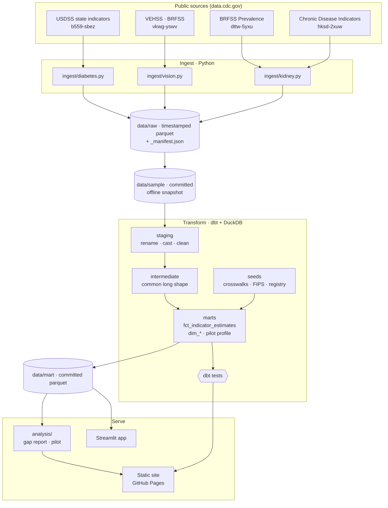
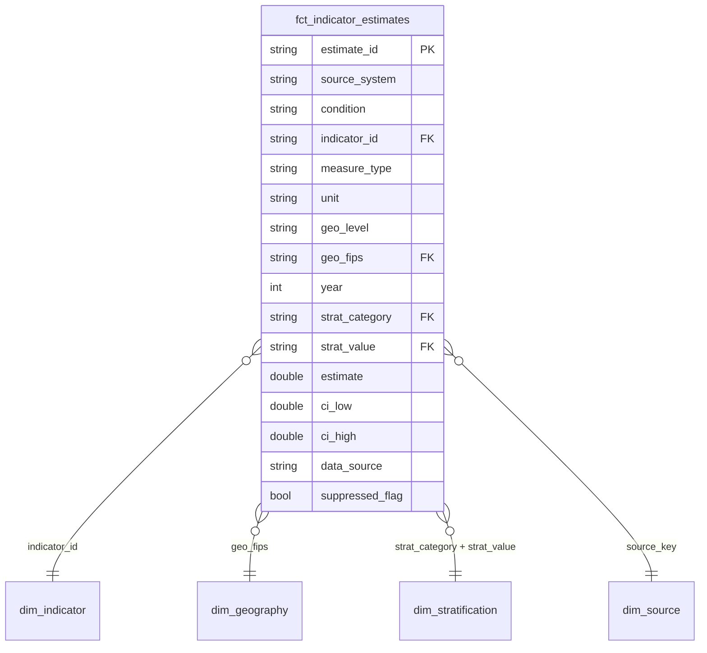

# Architecture

The lab is a small, file-based lakehouse: Python pulls public data into a raw
parquet zone, dbt (on DuckDB) harmonizes it into one indicator model, and two
lightweight front ends serve the result. No cloud warehouse, no servers to run.

## Layers

| Layer | Where | What it does | Key guarantees |
|---|---|---|---|
| Registry | `sources.yml` | One entry per dataset: id, URL, publisher, license, filter, access date | Single source of truth; `seed_source_registry.csv` is generated from it and a test fails on drift |
| Ingest | `ingest/` | Paged SODA pulls ordered by `:id`; per-domain modules | Retries with exponential backoff (429/5xx), no retry on other 4xx; row-count check against `count(*)`; idempotent (skips when upstream `rowsUpdatedAt` and filter are unchanged); stable schema even for all-null columns |
| Raw zone | `data/raw/<key>/<key>__<UTC>.parquet` | Immutable snapshots with `_loaded_at`, `_dataset_id`, `_source_rows_updated_at` | Last 3 snapshots kept; dbt reads only the latest |
| Offline snapshot | `data/sample/` | Verbatim copy of the latest real pull, committed | < 5 MB guard; lets CI, the app and the site build with no network |
| Staging | `transform/models/staging` | Rename, type-cast, trim/collapse whitespace | No business logic |
| Intermediate | `transform/models/intermediate` | Reshape four layouts into one long shape; derive measure basis and data status | Crosswalk completeness tested here |
| Seeds | `transform/seeds` | Indicator, stratification and data-source crosswalks; indicator catalog; state FIPS | Mappings are data, reviewed in PRs |
| Marts | `transform/models/marts` | `fct_indicator_estimates`, `dim_indicator`, `dim_geography`, `dim_stratification`, `dim_source`, `mart_pilot_state_profile` | Provenance on every row; tested keys, ranges and relationships |
| Serve | `app/`, `site_builder/`, `analysis/` | Dashboard, static site, reports | Read committed marts only |

## The harmonized model

Grain: one row per **source × indicator × measure type × geography × year × stratum**.
The same harmonized indicator can appear from more than one source (for example
diagnosed diabetes from USDSS and from CDI). `dim_indicator.primary_source_key`
names the source used for headline comparisons; `is_primary_source` marks those
rows, and the others stay available for overlap checks.

## Quality gates

`dbt build` runs every model and test in dependency order; a failing test stops
downstream models from building.

* **Keys and grain**: `estimate_id` unique and not null, plus a composite grain check.
* **Domains**: accepted values for condition, measure type, unit, geo level,
  stratification category and data source.
* **Ranges**: percentages within 0–100; rates non-negative; years in range.
* **Statistical sanity**: `ci_low <= estimate <= ci_high` (0.05 tolerance for
  independently rounded published values).
* **Referential integrity**: every fact row joins to each dimension, including the
  two-column stratification key.
* **Crosswalk completeness** (custom `unmapped_crosswalk_values` test): every
  source indicator/measure, stratifier, location and data-source label seen in
  the data must be mapped. A new upstream value fails the build with the exact
  combination to add.
* **Cross-source agreement** (warn only): flags cells where two sources disagree
  by more than 1 percentage point.

## CI/CD

| Workflow | Trigger | Steps |
|---|---|---|
| `ci.yml` | pull request, push to non-main branches | ruff, `dbt build` on the committed snapshot, pytest |
| `pages.yml` | push to `main`, manual | `make site` then `actions/deploy-pages` |
| `data-refresh.yml` | weekly (Mondays 09:17 UTC), manual | `make ingest` (live pull), `make transform`, regenerate reports, open a PR with the refreshed snapshot |

The refresh workflow never pushes to `main` directly: new data arrives as a pull
request, so the dbt tests and a human review gate every upstream change.
